  

  
  
  

## About

- **Building:** developer tools, AI/ML projects, system-level software
- **Learning:** machine learning, deep learning, operating systems, Linux kernel internals
- **Open to:** open-source collaboration, AI/ML applications, developer tooling
- **Need help with:** system programming, machine learning, Linux internals, production-ready software
- **Ask me about:** Python, C/C++, Java, machine learning, operating systems, software development

## Stack

**Languages & systems**

**ML & data**

 
Also: Keras, SciPy, Plotly, MLflow

**Web & backend**

**Tools**

## Currently

- Working through Linux kernel internals and OS fundamentals
- Going deeper into deep learning: training and deploying real models
- Building small tools that make other developers' work easier

<!--
## Projects

Pin your best 4-6 repos on your profile, or use pin cards:

-->

## GitHub

  
  

  

